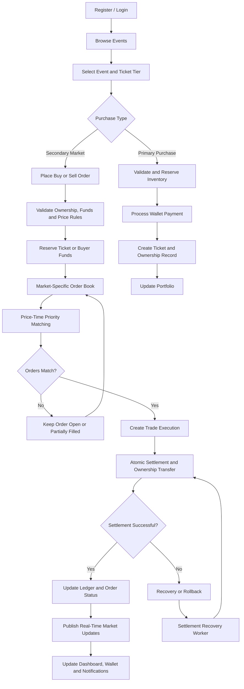

# PassFlow ⚡

### A Real-Time Secondary Ticket Marketplace & Trading Exchange

PassFlow is a full-stack ticket marketplace that enables users to discover events, purchase tickets at their original prices, and safely trade eligible tickets through a real-time secondary market. It combines an in-memory order-matching engine, price-time priority, live market data, wallet accounting, and transactional trade settlement to create a transparent and reliable ticket-trading experience.

## 🎯 What Problem Does PassFlow Solve?

Traditional ticket resale platforms often struggle with inflated resale prices, scalping, unreliable ownership transfers, delayed market updates, and inconsistent financial records.

PassFlow addresses these problems through price-capped resale rules, automated order matching, persistent ticket ownership records, atomic financial settlement, and real-time market visibility. It also provides event organizers and administrators with tools to manage events, inventory, users, and marketplace policies.

## ✨ Key Features

### 1. 🔐 Authentication, Profiles & Role-Based Access

- User registration, login, JWT-based authentication, and protected routes.
- Role-based access for customers/traders, event organizers, and administrators.
- User profiles, organizer applications and verification workflows.
- Validated API requests and protected account operations.

### 2. 🎟️ Event Management & Primary Ticket Sales

- Browse, search, and view event details, dates, venues, and ticket categories.
- Organizer dashboard for creating and managing events and ticket inventory.
- Support for multiple ticket tiers, original face values, and quantity limits.
- Inventory reservation and transactional primary purchases.
- Individual ticket records, ownership history, and direct ticket transfers.
- Protection against overselling and invalid ticket ownership changes.

### 3. 📈 In-Memory Order Book & Matching Engine

- Separate order books for each event and ticket category.
- Buy and sell orders with price-time priority: better prices match first, followed by earlier orders at the same price.
- FIFO queue support and a dedicated matching coordinator.
- Partial fills, remaining quantities, order cancellation, and lifecycle tracking.
- Market isolation, input validation, self-trade prevention, and execution-plan integrity checks.
- Persistent matching coordination, market execution queues, market leases, and recovery-aware market state.

### 4. ⚡ Live Market Data & Trading Dashboard

- Real-time market updates using Socket.IO.
- Live best bid, best ask, last traded price, trading volume, and order status.
- Aggregated bid/ask depth and recent trade feeds.
- Interactive price-history charts and market summaries.
- Live wallet and notification updates without requiring page reloads.

### 5. 💰 Wallet, Ledger & Atomic Trade Settlement

- User wallets with available and reserved balances.
- Deposits, withdrawals, fund reservations, and releases.
- Transactional wallet debits and credits with high-precision decimal arithmetic.
- Trade settlement that coordinates financial transfers and ticket ownership changes.
- Escrow-aware settlement states, rollback handling, and idempotent execution safeguards.
- Durable settlement recovery for executions left incomplete by failures.
- Ledger constraints and reconciliation-oriented data models to help detect inconsistencies.

### 6. 🛡️ Anti-Scalping, Anti-Bot & Transaction Safety

- Configurable resale price ceilings based on event and ticket category.
- Request validation, rate-limiting rules, and protected order-placement workflows.
- Ownership, inventory, and available-funds checks before accepting orders.
- Idempotency safeguards to reduce duplicate transaction processing.
- Database transactions, locking, unique execution records, and controlled settlement recovery.
- Market-specific isolation to prevent unrelated event or ticket-category orders from matching.

### 7. 🔨 Dutch Auctions & Alternative Trading

- Dutch auction creation with configurable starting and minimum prices.
- Time-dependent price decay and current-price calculation.
- Auction purchase flow with price locking and wallet debit processing.
- Support for scheduled auction start/end times and auction status tracking.

### 8. 📜 Orders, Trade History & Notifications

- Personal order history, order details, execution records, and trade history.
- Order cancellation and visibility into partial or completed fills.
- Ticket ownership and transfer history.
- Persistent notifications for relevant order, trade, and account events.
- Read/unread notification management and live notification delivery.

### 9. 🛠️ Administration, Monitoring & Solvency

- Administrative controls for users, organizer verification, events, and marketplace rules.
- Audit logs for sensitive administrative operations.
- Monitoring endpoints for application health, logs, and performance metrics.
- Reconciliation models and reporting workflows for financial consistency checks.
- Solvency-proof generation and public solvency verification endpoints.
- Operational readiness checks and settlement recovery during backend startup.

### 10. 🧪 Testing, Reliability & Performance Engineering

- Unit and integration tests for order books, matching strategies, order lifecycles, and settlements.
- Market-isolation, distributed-market coordination, and concurrency-focused tests.
- Wallet, ticket-purchase, API, notification, and auction test suites.
- Socket.IO load-testing scripts for simulated concurrent users.
- k6 scripts for trading-performance and load testing.
- Dedicated architecture documentation for matching, concurrency, and settlement recovery.

## ⚙️ Order Book, Matching Algorithm & Concurrency Architecture

### 1. Order Book Design

PassFlow maintains separate order books for each event and ticket category. Each book tracks pending buy and sell orders, their prices, remaining quantities, timestamps, and execution status.

The matching engine follows **price-time priority**:

- **Buy orders:** Higher prices receive priority; orders at equal prices are processed FIFO.
- **Sell orders:** Lower prices receive priority; orders at equal prices are processed FIFO.
- **Matching condition:** A trade can execute when the best available buy price is greater than or equal to the best available sell price.
- **Partial execution:** If order quantities differ, the smaller quantity is filled and the unfilled quantity remains in the book.
- **Cancellation:** Eligible pending orders can be cancelled, with their remaining reserved funds or ticket quantities released through the appropriate lifecycle.
- **Market isolation:** Orders are matched only within their corresponding event and ticket category.

### 2. Matching Algorithm & Complexity

For each incoming order, the engine validates the order, identifies the best opposing order, and repeatedly matches eligible orders until no further match is possible or the incoming quantity is filled.

| Operation                | Complexity                                                                  |
| ------------------------ | --------------------------------------------------------------------------- |
| Best-price lookup        | Depends on the underlying order-book data structure                         |
| Insert order             | Depends on the underlying order-book data structure                         |
| Match one resting order  | (O(1)) execution work, excluding data-structure updates and settlement      |
| Match (k) resting orders | (O(k)) matching iterations, excluding data-structure updates and settlement |
| Cancel order             | Depends on order indexing and queue implementation                          |

**Complexity note:** Total complexity depends on the actual data structures used for price levels, FIFO queues, and order lookup. For example, a balanced-tree price index typically gives (O(\log P)) price-level updates, where (P) is the number of price levels. These are data-structure-based bounds, not benchmark measurements.

### 3. Concurrency Architecture

PassFlow separates in-memory order matching from durable financial settlement to reduce race conditions and maintain consistent state.

1. **Order validation:** Validate order parameters, ownership, available funds, and applicable resale-price rules.
2. **Resource reservation:** Reserve the required buyer funds or seller ticket quantity before execution.
3. **Market coordination:** Route execution through the matching coordinator and serialize conflicting operations for the same market.
4. **Execution planning:** Identify eligible matches and validate the execution plan before committing trades.
5. **Transactional settlement:** Persist trade executions, wallet changes, ledger entries, and ticket ownership updates using database transactions and applicable locking or uniqueness constraints.
6. **Failure recovery:** Use idempotency safeguards and settlement recovery mechanisms to handle interrupted executions without blindly applying a trade twice.
7. **Real-time publication:** Publish successful market, order, wallet, and notification updates to connected clients.

### 4. Consistency & Reliability Guarantees

- **Deterministic priority:** Orders follow price-time priority within their market.
- **Market isolation:** Different event and ticket-category books remain logically separate.
- **Financial consistency:** Settlement operations use transactional database updates and precise decimal arithmetic.
- **Duplicate protection:** Idempotency and unique execution records help prevent duplicate settlement.
- **Recoverability:** Persisted execution states support investigation and recovery after failures.
- **Observable performance:** Dedicated load-test scripts help measure throughput, latency, and behavior under concurrent requests.


## 🔄 System Workflow

The following flow illustrates the main ticket purchase, resale, matching, and settlement lifecycle.



## 🧰 Tech Stack

\<table>
\<tr>\<th>Layer\</th>\<th>Technologies\</th>\</tr>
\<tr>\<td>Frontend\</td>\<td>React 19, Vite, JavaScript, Zustand, CSS\</td>\</tr>
\<tr>\<td>Charts & UI\</td>\<td>TradingView Lightweight Charts, Lucide React\</td>\</tr>
\<tr>\<td>Backend\</td>\<td>Node.js, Express 5, ES Modules\</td>\</tr>
\<tr>\<td>Database & ORM\</td>\<td>PostgreSQL, Prisma ORM, SQL migrations\</td>\</tr>
\<tr>\<td>Real-Time Communication\</td>\<td>Socket.IO / WebSockets\</td>\</tr>
\<tr>\<td>Authentication & Validation\</td>\<td>JWT, bcryptjs, Zod\</td>\</tr>
\<tr>\<td>Financial Precision\</td>\<td>Decimal.js, transactional ledger operations\</td>\</tr>
\<tr>\<td>Performance & Coordination\</td>\<td>In-memory order books, matching strategies, Redis client integration\</td>\</tr>
\<tr>\<td>Testing\</td>\<td>Jest, Supertest, Node.js test runner, k6\</td>\</tr>
\<tr>\<td>Development Tools\</td>\<td>Git, GitHub, npm, Prisma CLI\</td>\</tr>
\</table>

## 📂 Project Structure

```text
passflow/
├── frontend/
│   ├── public/
│   ├── src/
│   │   ├── components/       # Shared UI and trading components
│   │   ├── context/          # Application state and context
│   │   ├── hooks/            # Market-stream hooks
│   │   ├── pages/            # Events, market, wallet, tickets,
│   │   │                     # orders, profile, admin and organizer
│   │   ├── services/         # API and Socket.IO clients
│   │   ├── store/            # Zustand store
│   │   └── utils/            # Formatting and event adapters
│   ├── .env.example
│   └── package.json
│
├── backend/
│   ├── docs/                 # Architecture and matching-engine docs
│   ├── prisma/
│   │   ├── migrations/       # Database schema migrations
│   │   └── schema.prisma
│   ├── scripts/              # Data seeding and verification scripts
│   ├── src/
│   │   ├── config/           # Environment and CORS configuration
│   │   ├── controllers/      # HTTP request handlers
│   │   ├── db/               # Prisma and Redis clients
│   │   ├── middleware/       # Request and access middleware
│   │   ├── routes/           # REST API routes
│   │   ├── schemas/          # Request validation
│   │   ├── services/
│   │   │   ├── matching/     # Order book and matching engine
│   │   │   ├── order/        # Order lifecycle
│   │   │   ├── settlement/   # Trade settlement and recovery
│   │   │   └── wallet/       # Wallet and ledger operations
│   │   └── utils/
│   ├── tests/
│   │   ├── matching/
│   │   ├── settlement/
│   │   ├── wallet/
│   │   ├── order/
│   │   └── load/
│   ├── .env.example
│   ├── server.js
│   └── package.json
│
└── README.md
```

## 🚀 Getting Started

### Prerequisites

- Node.js and npm
- PostgreSQL database (local PostgreSQL, Neon, or another compatible provider)
- Git
- Redis, if enabling the corresponding optional infrastructure integrations

### 1. Clone the Repository

```bash
git clone https://github.com/krnaman2007/passflow.git
cd passflow
```

### 2. Configure the Backend

```bash
cd backend
npm install
```

Create a `.env` file by copying `.env.example`, then configure your database and secrets:

```env
PORT=5001
NODE_ENV=development
DATABASE_URL="your_postgresql_connection_string"
DIRECT_URL="your_direct_postgresql_connection_string"
JWT_SECRET="your_secure_secret_at_least_32_characters"
JWT_REFRESH_SECRET="your_separate_refresh_token_secret"
FRONTEND_URL="http://localhost:5173"
```

Use valid connection strings and generate your own secrets. Never commit `.env` files or credentials.

Generate Prisma Client and apply the existing migrations:

```bash
npx prisma generate
npx prisma migrate deploy
npm run dev
```

The backend runs at `http://localhost:5001` when configured with the default port.

### 3. Configure the Frontend

Open a second terminal:

```bash
cd frontend
npm install
```

Create a `.env` file from `.env.example` and set the backend URL:

```env
VITE_BACKEND_URL=http://localhost:5001
```

Start the frontend:

```bash
npm run dev
```

Open the Vite URL shown in your terminal, normally `http://localhost:5173`.

### 4. Run Tests

Backend tests:

```bash
cd backend
npm test
```

Frontend tests:

```bash
cd frontend
npm test
```

Build the frontend:

```bash
npm run build
```

Optional load tests require k6:

```bash
cd backend
npm run test:load:k6
```

For the Socket.IO load-test script, use:

```bash
npm run test:load:ws
```

Ensure the database, environment variables, and any required test fixtures are configured before running integration or load tests.

