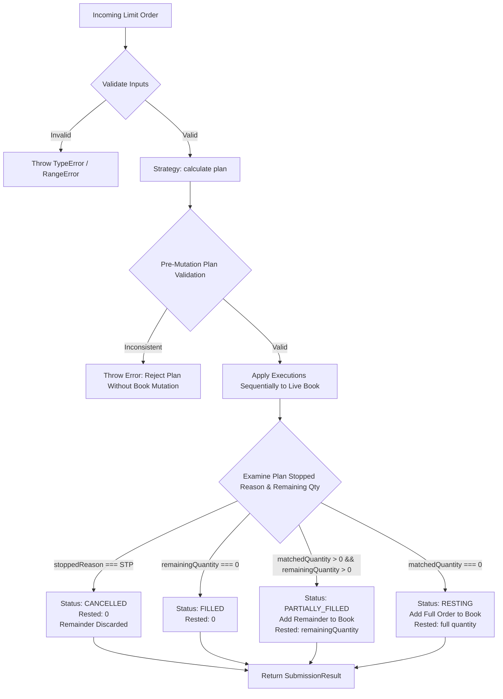

# MatchingCoordinator — In-Memory Matching Lifecycle Coordinator

## 1. Overview and Core Purpose

`MatchingCoordinator` is the bridge between the pure matching strategy (`PriceTimePriority`) and the stateful in-memory `OrderBook`. 

Prior to this component, `PriceTimePriority` calculated proposed executions without mutating order book state, and `OrderBook` provided granular mutation methods without execution-loop coordination. `MatchingCoordinator` governs the end-to-end lifecycle of an incoming limit order: validating inputs, requesting an execution plan from the strategy, verifying the integrity of the proposed plan against the live book, sequentially applying executions to resting orders, and properly handling any unfilled remainder according to exchange rules.

---

## 2. Responsibilities and Non-Responsibilities

### 2.1 Explicit Responsibilities
1. **Input Validation**: Enforces the contract for the target `OrderBook` and incoming limit orders (IDs, sides, integer tick prices, positive quantities, and event/ticket tier alignment).
2. **Strategy Coordination**: Delegates matching-plan computation to an injected or default pure matching strategy (`PriceTimePriority`).
3. **Pre-Mutation Plan Validation**: Rigorously validates the calculated plan against the live book before committing any state changes.
4. **Sequential Execution Application**: Applies fills against resting orders using public `OrderBook` mutation methods (`book.reduceOrderQuantity()`), ensuring resting orders and empty price levels are properly reduced or removed.
5. **Incoming Order Lifecycle Management**: Correctly transitions the incoming order to one of four terminal lifecycle statuses: `FILLED`, `PARTIALLY_FILLED`, `RESTING`, or `CANCELLED`.
6. **Self-Trade Prevention (STP) Handling**: Preserves legitimate executions occurring prior to an STP conflict while cancelling the incoming remainder and preventing it from entering the book.
7. **Detached Result Emission**: Returns a clean, decoupled summary of executions and final order state without leaking internal mutable structures.

### 2.2 Explicit Non-Responsibilities (Out of Scope for Step 6)
- **Database Persistence**: No database models, Prisma transactions, or persistent trade logging.
- **Financial Settlement**: No wallet debits/credits, escrow locking, or fiat/crypto payments.
- **Ownership Transfer**: No issuance or transfer of ticket NFT/barcodes.
- **Market Orders & Collars**: Limit orders only; price collar enforcement is reserved for subsequent steps.
- **API & Transport**: No Express controllers, REST routes, or Socket.IO websocket feeds.
- **Concurrency & Clustering**: Single-process, synchronous in-memory coordination; no distributed locking, Redis streams, or cross-node synchronization.

---

## 3. Public API Specification

### Constructor
```javascript
import { MatchingCoordinator } from './matching-coordinator.js';
import { PriceTimePriority } from './price-time-priority.js';

const coordinator = new MatchingCoordinator({
  strategy = new PriceTimePriority()
} = {});
```
- **Arguments**:
  - `options` *(Object, optional)*:
    - `strategy` *(Object, optional)*: An object implementing `calculate(book, incomingOrder)`. Defaults to a new instance of `PriceTimePriority`.
- **Throws**:
  - `TypeError` if `strategy` is not an object or lacks a `calculate` method.

### `submitLimitOrder(book, incomingOrder)`
```javascript
const result = coordinator.submitLimitOrder(book, incomingOrder);
```
- **Arguments**:
  - `book` *(OrderBook, required)*: Live two-sided order book.
  - `incomingOrder` *(Object, required)*:
    - `id` *(string, non-empty)*: Unique order identifier.
    - `side` *(string)*: `'BID'` or `'ASK'`.
    - `price` *(number)*: Positive safe integer representing ticks / minor units (e.g. cents).
    - `remainingQuantity` *(number)*: Positive safe integer quantity.
    - `userId` *(string, optional)*: User/account identifier for STP validation.
    - `eventId` *(string, optional)*: Must match `book.eventId` if provided.
    - `ticketCategoryId` *(string, optional)*: Must match `book.ticketCategoryId` if provided.
- **Returns**: `SubmissionResult`
```typescript
interface SubmissionResult {
  incomingOrderId: string;
  side: 'BID' | 'ASK';
  status: 'FILLED' | 'PARTIALLY_FILLED' | 'RESTING' | 'CANCELLED';
  executions: ExecutionResult[];
  matchedQuantity: number;
  remainingQuantity: number;
  restedQuantity: number;
  stoppedReason: 'SELF_TRADE_PREVENTION' | 'PRICE_LIMIT_REACHED' | 'BOOK_EXHAUSTED' | null;
}

interface ExecutionResult {
  incomingOrderId: string;
  restingOrderId: string;
  price: number;
  quantity: number;
  restingOrderRemainingAfterExecution: number;
  incomingUserId?: string;
  restingUserId?: string;
}
```

---

## 4. Matching Flow & Lifecycle Management



### Lifecycle Status Vocabulary

| Status | Description | Executions | Book Mutation for Incoming Order |
| :--- | :--- | :--- | :--- |
| `FILLED` | Incoming order was completely executed across resting orders. | ≥ 1 | Order is **never** added to the book. `restedQuantity: 0`. |
| `PARTIALLY_FILLED` | Executed some quantity, remainder rests in the book. | ≥ 1 | Unfilled remainder is added to the book once. `restedQuantity: remainingQuantity`. |
| `RESTING` | No matching orders found (empty book or no price overlap). | 0 | Entire incoming order is added to the book. `restedQuantity: originalQuantity`. |
| `CANCELLED` | Execution stopped by Self-Trade Prevention (STP). | ≥ 0 | Remaining quantity is cancelled and **never** rests in the book. `restedQuantity: 0`. |

---

## 5. Pre-Mutation Plan Validation

To prevent corrupting book state due to faulty or injected strategies, `MatchingCoordinator` performs pre-mutation verification before modifying the `OrderBook`:
1. **Quantity Conservation**: Verifies `matchedQuantity + remainingQuantity === incomingOrder.remainingQuantity`.
2. **Execution Sum Check**: Confirms $\sum \text{exec.quantity} == \text{plan.matchedQuantity}$.
3. **Price Limit Protection**:
   - For incoming `BID`: every execution price $\le$ `incomingOrder.price`.
   - For incoming `ASK`: every execution price $\ge$ `incomingOrder.price`.
4. **Passive Price Matching**: Every execution price must strictly equal the resting order's posted price.
5. **Opposing Side Integrity**: Confirms every resting order exists on the opposite side of the live book (`ASK` for incoming `BID`, `BID` for incoming `ASK`).
6. **Cumulative Resting Depth Check**: Tracks simulated deductions per resting order; rejects plans that propose filling more than a resting order's available remaining quantity.

If any check fails, an error is thrown, leaving the `OrderBook` in its original, untouched state.

---

## 6. Self-Trade Prevention (STP)

PassFlow enforces strict Self-Trade Prevention:
- A user may not execute against their own resting order.
- When an incoming order encounters a resting order from the same `userId`:
  1. Any valid executions against prior orders in the price-time queue are preserved and applied.
  2. The same-user resting order is **not** matched.
  3. Lower-priority orders behind the conflicting order are **not** matched (no queue skipping).
  4. The unexecuted remainder of the incoming order is **cancelled** (`status: 'CANCELLED'`) and never rests in the book.
  5. `stoppedReason` is set to `'SELF_TRADE_PREVENTION'`.

---

## 7. Complexity Analysis

### Time Complexity

Let:
- $M$: Number of price levels visited during strategy evaluation.
- $K$: Number of resting orders matched.
- $Q_p$: Number of orders in the queue at price level $p$.
- $P$: Number of active price levels on the target book side.

| Step | Complexity | Description |
| :--- | :--- | :--- |
| **Input Validation** | $O(1)$ | Hash lookup `book.getOrder(id)` for duplicate ID verification. |
| **Plan Calculation** | $O(M + K)$ | `PriceTimePriority` traverses sorted price levels and linked-list queues until filled, exhausted, or stopped. |
| **Plan Validation** | $O(K)$ | Hash lookups `book.getOrder(restingId)` and checks across proposed executions, validating prices, sides, and tracking cumulative quantities in an $O(K)$ map. |
| **Execution Application** | $O(K \cdot (\bar{Q}_p + P))$ worst-case<br>$O(K \cdot P)$ typical | For each execution, `book.reduceOrderQuantity`: <br>1. Locates order in `_orders` map in $O(1)$.<br>2. Deducts quantity in $O(1)$.<br>3. If fully filled, unlinks from `PriceLevel`: `_ordersById` map deletion is $O(1)$, but `FIFOQueue.remove(order)` performs a **linear scan** of the doubly linked list ($O(Q_p)$). It does **not** store direct node pointers. When matching at the head of the queue (standard price-time priority), this scan completes in $O(1)$ steps; for non-head removals, it requires $O(Q_p)$.<br>4. If the price level becomes empty, `OrderBookSide._removeLevel` performs binary search ($O(\log P)$) and array `splice` ($O(P)$). |
| **Remainder Insertion** | $O(P)$ | Inserting the unfilled remainder into `OrderBook` uses binary search $O(\log P)$ to locate/insert into `_prices` array ($O(P)$ splice if level is newly created), followed by $O(1)$ FIFO enqueue. |
| **Total Time** | **$O(M + K \cdot (\bar{Q}_p + P))$** | Worst-case occurs when fills deplete entire price levels and require queue scans. Under typical price-time execution where fills hit queue heads and levels remain populated, time is **$O(M + K)$**. |

### Space Complexity
- **Validation Map**: $O(K)$ auxiliary space to track simulated reductions across distinct resting orders during plan validation.
- **Execution Output**: $O(K)$ auxiliary space to construct decoupled `ExecutionResult` objects.
- **Total Additional Space**: **$O(K)$**, directly proportional to the number of fills produced.

---

## 8. In-Memory Limitations and Future Requirements

### Application Failure Model
- **No In-Memory Rollback**: Mutations applied by `submitLimitOrder` are committed sequentially and synchronously to the live in-memory `OrderBook`.
- **Pre-Mutation Validation Barrier**: The primary line of defense is comprehensive pre-mutation validation (`_validatePlan`). Any logical contradiction, limit violation, side mismatch, or quantity deficit aborts the operation *before* any book mutation is performed.
- **Partial Application on Unexpected Error**: If an unexpected fatal error occurs mid-application (e.g. process termination, memory exhaustion, or hardware fault after applying fill $i$ but before fill $i+1$ or remainder placement), previously applied fills remain in RAM while subsequent executions and remainder placement are abandoned. The engine does **not** simulate transactional rollback or two-phase commit in RAM.
- **Production Recovery Requirement**: In a production exchange, atomicity and crash recovery must be provided by an upstream Write-Ahead Log (WAL) or event-sourcing journal. In the event of an unhandled crash, the in-memory book is discarded and rehydrated deterministically by replaying confirmed order events from the log.

### Single-Process / Single-Thread Limitations
- `MatchingCoordinator` relies on Node.js synchronous execution to ensure race-free validation and application within a single event loop.
- It does **not** protect against concurrent writes across multiple Node.js worker threads or cluster processes. A single-writer architecture (e.g. dedicated event loop or actor per order book) is required for multi-threaded or distributed scaling.

### Crash Safety & Persistence Boundary
- State mutations occur purely in RAM. If the Node.js process terminates unexpectedly, uncommitted order book state is lost.
- **Not for Financial Settlement**: Fills returned by `MatchingCoordinator` are execution proposals within the engine. They must be validated, recorded in persistent relational storage (e.g., PostgreSQL transactions), and routed through settlement pipelines (escrow release, ticket inventory reassignment, balance debit/credit) before considered final.

### Future Architectural Path (Step 7+)
1. **Command Sourcing / Write-Ahead Logging (WAL)**: Journaling incoming order events to disk or message log before coordinator execution.
2. **Relational Ledger & DB Sync**: Asynchronous or transactional persistence of orders, trades, and account balances in Neon / PostgreSQL.
3. **Resale Price Collars**: Enforcing league or event-mandated price floors and ceilings prior to coordinator submission.
